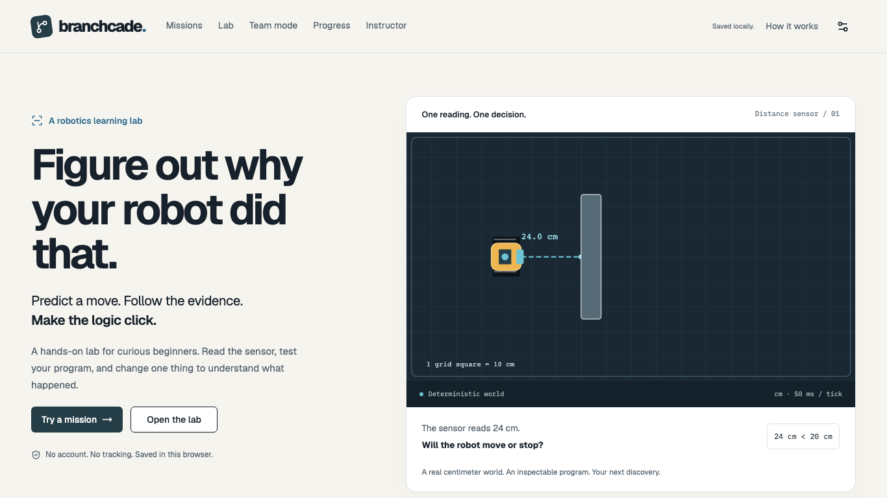

# Branchcade

**Make the logic click.** A browser-based robotics learning laboratory: predict a robot’s action, follow its actual sensor readings and execution trace, investigate surprising results, change one parameter and test your understanding with a different problem.



## What works in this checkpoint

This checkpoint includes the A–H implementation and the **Parts I/J verification and completion pass**. It provides a robotics workbench, adaptive learning cycle, eight versioned missions, local team learning and evidence-based reports. Current verification and remaining human/hosting work are recorded in [HANDOFF](docs/HANDOFF.md) and [I/J acceptance](docs/PARTS_IJ_ACCEPTANCE.md).

- Eight authored investigations: **The 20 cm question**, **Black Line Stop**, **Wrong-Way Branch**, **The Extra Lap**, **The Loop That Never Ends**, **Call the Helper**, **Color & Distance**, and **Mystery Malfunction**. Reference programs satisfy actual physical and concept predicates; deliberately faulty starters require repair.
- Prediction and confidence locked before reveal; exact operands and trace replay; no generated-code execution.
- Fourteen possible ideas, twenty-two executable probe templates and adaptive questions keep one wrong answer ambiguous. Later answers can distinguish reversed comparison direction from expecting a sensor to stop the robot itself, with inspectable support and contradictions.
- Bounded, executed counterexample search over legal parameter changes; compare actual baseline/changed traces, then try a distinct adaptive transfer challenge. No claim of mastery from one answer.
- Free Lab: six templates, legal box/circle/zone and robot editing, world undo/redo, saved world collection, real sensor range and comparator editing, camera controls and checksummed import/export previews. Blockly supports movement, sensors, logic, loops, variables, helpers and debug blocks; previews remain inert text.
- Multiple anonymous learners, derived progress stamps and replay, local instructor filters/assignments/CSV/JSON/print, validated merge or replace with rollback, scoped deletion and typed erase-all. Teams of two to six collect individual predictions and role contributions before huddle, shared hints and optional second questions, real execution and role rotation. Team evidence stays separate from individual mastery.
- Responsive working routes, keyboard dialogs, error/empty recovery, local theme/text/contrast/reduced-motion preferences, CI and persistent tests.

No fabricated progress, fake online teammates, copied proprietary robot artwork, ads, child accounts, remote learner records or LLM diagnosis. The creator’s motivation comes from teaching a small group of about six younger robotics students; no invented classroom outcomes or efficacy percentages.

## Install and run

Use maintained Node 24.22.1 (see `.nvmrc`), npm and the committed lockfile. The app requires **zero API keys**.

```bash
npm ci
npm run dev
# Open http://127.0.0.1:5173
npm run check
npx playwright install chromium firefox
npm run test:e2e
npm run format:check
npm run scan:secrets
```

`check` runs ESLint, strict TypeScript, Vitest and the production build. `npm run test -- --run` runs unit/integration/component tests; `npm run test:a11y` selects browser accessibility checks. Browser failure traces/screenshots are in `test-results/` and the HTML report in `playwright-report/`. Actual counts/results and failures repaired: [TEST_REPORT](docs/TEST_REPORT.md).

## Walk through the actual product

1. Home → Try a mission → choose solo, a generated alias and a guided first mission.
2. Read24 cm and the if/else program. Predict **Stop in place** intentionally, then lock/run.
3. Inspect `24 <20 is false`, the else branch and actual 10 cm motion in the trace.
4. Answer the adaptive investigation questions using your actual reasoning. Open “Why are you asking?” and inspect how fitting and conflicting answers affect possible explanations.
5. Generate a targeted experiment, predict its changed outcome and run it. Change the offered parameter and compare the real baseline/changed traces; the selected change depends on your answers.
6. Try a new-numbers challenge, commit a prediction and reveal the real result. Open Progress/Instructor to inspect the saved record, its evidence stamps, export it or explicitly delete it.

These are demo instructions, not a claim that real children produced those answers. Correct initial predictions can skip remedial probes.

## Architecture and source tour

```text
validated World + typed Program AST
             ↓ bounded interpreter + fixed 50ms engine
passive sensor rays → actual events → goal predicates
             ↓
SVG / trace → prediction comparison → probes / counterexamples
             ↓
distinct transfer → versioned local IndexedDB → instructor / export
```

- `src/domain/{types,schemas,invariants}.ts`: versioned contracts, structural limits, canonical JSON and SHA-256 identities.
- `src/engine/{geometry,robot,sensors,reducer,replay}.ts`: centimeter geometry, continuous swept-circle contact, passive sensing, pause/reset and exact snapshots.
- `src/interpreter/`: validated AST, safe numeric/boolean evaluation, bounded loops/functions, real Blockly adapter and inert text previews.
- `src/learning/`: taxonomy, executable mental models, explicit evidence rules, contradictions, adaptive probe selection, bounded executed counterexamples and deduplicated transfer evidence.
- `src/missions/catalog.ts`: eight authored missions, reference solutions, explicit physical/concept goals and distinct transfer variants. New missions must validate and demonstrate actual goal success/failure; changing a status flag is not completion.
- `src/storage/`: IndexedDB, guarded deterministic legacy migration, append-only execution records and validated import/export.
- `src/collaboration/`: local aliases, role responsibilities, private predictions and rotation.
- `src/features/`: working routes; `src/styles/`: design tokens; `tests/` and `e2e/`: persistent reproducible evidence.
- [ARCHITECTURE](docs/ARCHITECTURE.md), [DESIGN_SYSTEM](docs/DESIGN_SYSTEM.md), [ADR](docs/ADR.md), [HANDOFF](docs/HANDOFF.md), [STATUS](docs/STATUS.json), [original/full spec](docs/SPEC.md).

## Local data, privacy and access

A random pseudonym is enough. No age, email or real name is required. Records stay in this browser’s IndexedDB; a different browser/device does not automatically share them. Team mode is single-device pass-and-play, not internet multiplayer. Instructor metrics show this browser only.

Settings exports versioned JSON and validates imports before an explicit merge or replacement confirmation. Existing IDs win during merge; failed durable writes leave the previous dataset intact. Imports reject unknown versions, invalid geometry/ASTs, duplicate IDs, unsafe structure, identity/trace mismatches and unsupported completion claims. A documented pre-release v0 alias shape migrates deterministically; unknown data is not silently rewritten. Instructor exports CSV and confirms all-data deletion. Downloaded files are not deleted by clearing the app. On shared school devices, other people with the same browser profile can inspect local data. Do not put personal information in optional reasoning or exported files. Hosting services may log ordinary page requests.

[Security/privacy details](docs/SECURITY_PRIVACY.md). Local fonts and original SVGs avoid third-party asset requests. No analytics or remote error telemetry exists. Offline operation is limited to loaded/cached assets; no service-worker/PWA installation claim yet.

## Deployment readiness

`npm run build` produces `dist/`; `npm run preview -- --port 4173` serves it locally. SPA route fallback configs are included for Vercel (`vercel.json`) and Netlify/Cloudflare-compatible static hosting (`public/_redirects`). Deployment is **not claimed**: the current Vercel CLI reports no configured credentials. See [deployment handoff](docs/DEPLOYMENT.md) for the exact owner authorization and post-publication checks.

After the owner authorizes a hosting account, from this repository:

```bash
vercel login
vercel --prod
# Or publish dist/ to an authorized static host with SPA rewrites.
```

Then verify the actual public URL, direct `/missions/m01` refresh, privacy/network behavior and the guided journey. Never substitute localhost or an invented URL for deployment proof.

## Current limitations and next work

The I/J gate map distinguishes tested implementation from pending human review and hosting authorization. Six of fourteen possible ideas require optional investigation rather than a wrong first-action answer in the eight missions. Mental models simplify one rule at a time; scores are heuristics, not probabilities. Counterexample search is bounded and may return a factual no-candidate explanation. Numeric world controls provide accessible alternatives to pointer editing. Blockly spatial authoring can require a pointer; inert program text is available for inspection. The interpreter yields cooperatively within hard budgets on the main thread; presentation playback is separate from physical time. No worker/PWA, WebKit, physical Chromebook, human usability study or public deployment is claimed. The lazy Blockly bundle emits a documented size warning. ESLint 9 is retained for current jsx-a11y peer compatibility. Dedicated Parts K/L have not been started.

## Student ownership, AI disclosure and licensing

This session’s source, original SVGs, docs and tests are AI-assisted. Student review/contributions have **not** been invented. Creators must personally inspect and revise core algorithms, test actual behavior and document real work before competition submission. [AI_ASSISTANCE_LOG](docs/AI_ASSISTANCE_LOG.md) lists review questions. [USER_TESTING](docs/USER_TESTING.md) is a blank protocol, not fabricated results. [DEMO_SCRIPT](docs/DEMO_SCRIPT.md) and [SUBMISSION_GUIDE](docs/SUBMISSION_GUIDE.md) separate foundation from later shipping work. Third-party notices are in [LICENSE_NOTICES](docs/LICENSE_NOTICES.md). No LEGO or other proprietary affiliation is implied. The repository owner must choose the project’s distribution license; bundled dependencies retain theirs.

## Troubleshooting

- Blank/failed screen: use the visible reload recovery; inspect actual console errors, not a fabricated success message.
- Storage unavailable/corrupt: the visible notice identifies in-memory mode; export before closing. Erase requires explicit confirmation; imports never silently replace existing data.
- Missing editor socket/disconnected block: connect one supported program and Apply blocks; errors identify the block/input. Previews are not executable.
- Loop budget reached: reduce repeats or make the condition change; do not disable the budget.
- Port in use: choose another dev port; E2E expects 4173, so keep its configuration and preview consistent.
- Shared-computer continuation: fetch/pull clean main, read HANDOFF and run gates. Do not infer completion from chat history or a stale marker.

## Part F robotics/debugger

New runs use continuous swept-circle contact, bounded small-step interpretation, source-linked sensor/comparison/loop/function traces, distinct **Step code**/**Step tick**,1–4× outcome-invariant replay and **Stop & Edit** locking. Nominal Free Lab is600×360cm with a16cm robot; explicit authored mission worlds retain their original scale. Null distance comparisons are errors unless guarded with **is detected AND**. Noise is off by default and seed-labeled when enabled. Stage camera pan and SVG snapshot downloads are local.

Existing A–E attempts retain their original execution-version checksums. New attempts/team results record engineVersion2; missing/1 means historical replay. See [Part F acceptance](docs/PART_F_ACCEPTANCE.md) for exact limits, numerical tests and intentional semantics. The reusable continuation prompt in AGENTS.md/HANDOFF.md preserves main-only commits and honest verification.
