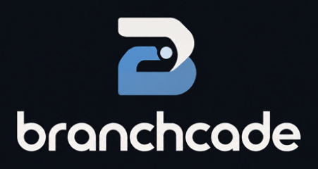
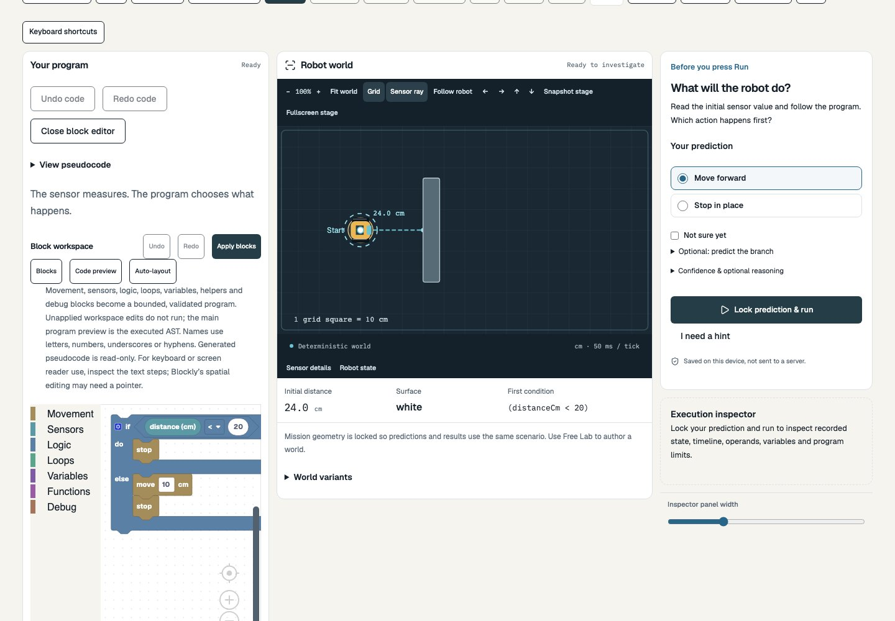
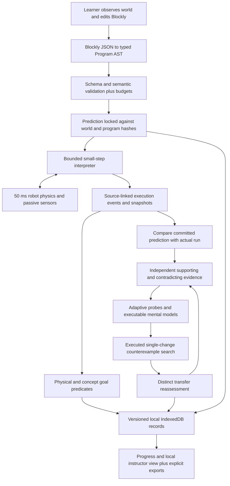

# Branchcade

<p align="center"></p>

**Make the logic click.** Branchcade helps beginner roboticists discover why their code behaves as it does through predictions, real sensor measurements, trace inspection and controlled experiments.



_Real local production build, not a mockup. The screenshot uses a generated demonstration alias, not student data. [Capture and rehearsal evidence](docs/PART_K_ACCEPTANCE.md)._

## Why it exists

A beginner can copy a robot program without understanding why it moves. Branchcade asks what the learner expects **before** revealing execution, then uses follow-up examples to investigate a surprising answer rather than declaring a diagnosis.

The owner reports that helping younger FLL learners program LEGO SPIKE Prime inspired the project. That is an owner-reported motivation, not a verified classroom study or a claim of improved learning. The intended audience is beginning roboticists (approximately ages 9–13), instructors and small robotics teams.

**Observe → Predict → Execute → Compare → Investigate → Experiment → Reassess.** The runtime learning system is deterministic TypeScript, not an LLM tutor. AI coding assistance during development is a separate, extensively documented fact.

## Explore what works

- **Physical robot simulation:** centimeter worlds, fixed 50 ms logical ticks, continuous collision detection, distance rays, floor-color footprint, and explicit out-of-range readings. Sensors measure; program instructions control motion.
- **Blockly programming:** movement, comparisons, booleans, loops, variables and zero-argument helpers become a validated typed AST. Readable previews are inert text; generated JavaScript is never executed.
- **Explainable debugging:** real operands, source-linked events, variables/call stack, code/tick stepping, rewind, replay and outcome-invariant playback speed.
- **Investigation:** 14 executable single-rule mental models and 22 probe templates compare plausible interpretations with observed answers. One wrong answer stays ambiguous; scores are heuristics, not probabilities.
- **Experiments and transfer:** bounded counterexample search actually executes legal one-parameter edits. New-number challenges differ from the initial scenario; repeated revealed answers do not manufacture independent evidence.
- **Eight missions:** M01 **The Wall Problem**, M02 **Black Line Stop**, M03 **Wrong-Way Branch**, M04 **The Extra Lap**, M05 **The Loop That Never Ends**, M06 **Call the Helper**, M07 **Color & Distance**, M08 **Mystery Malfunction** (capstone). References, flawed variants, hints and multiple success worlds have executable checks.
- **Free Lab:** six presets, legal obstacle/zone/robot editing, numeric alternatives to dragging, sensor range, deliberate comparator editing, world history, local saves and validated world import/export.
- **Local teamwork:** 2–6 aliases share one computer through private handoffs, meaningful role contributions, a shared hypothesis, actual runs, assistance and role rotation. This is not remote multiplayer; team evidence does not grant solo mastery.
- **Actual progress and instructor review:** derived evidence stamps, versioned attempts/replay, local filters, assignments, CSV/JSON and print. Reports describe this browser only, never a remote class.
- **Local data controls:** no learner account or API key; versioned export/import with preview, scoped deletion, typed erase-all and visible in-memory recovery when storage fails.

## Install and run

Use **Node 24.22.1** from [.nvmrc](.nvmrc) and npm (this checkpoint was tested with **npm 11.19.0**). With nvm already installed, `nvm install && nvm use` selects the pinned runtime. Keep `package-lock.json`; use `npm ci`, not an unreviewed dependency upgrade.

```bash
git clone https://github.com/HrishikeshLenin13/Branchcade.git
cd Branchcade
npm ci
npm run dev
# Open the local URL printed by Vite (normally http://127.0.0.1:5173).
```

| Command                                       | Purpose                                                                           |
| --------------------------------------------- | --------------------------------------------------------------------------------- |
| `npm run check`                               | ESLint, strict TypeScript, all unit/integration/component tests, production build |
| `npm run test -- --run`                       | Non-watch unit/integration/component suite                                        |
| `npm run test:watch`                          | Watch tests while editing                                                         |
| `npm run lint` / `npm run typecheck`          | Independent static checks                                                         |
| `npm run build`                               | Build static `dist/`                                                              |
| `npm run preview -- --port 4173 --strictPort` | Serve the existing production build locally                                       |
| `npx playwright install chromium firefox`     | Install browsers for the locked Playwright version (Linux CI uses `--with-deps`)  |
| `npm run test:e2e`                            | Both configured production browser projects                                       |
| `npm run test:e2e -- --project=chromium`      | Chromium only; label results accordingly                                          |
| `npm run test:a11y`                           | Browser tests whose titles match accessibility                                    |
| `npm run format:check` / `npm run format`     | Check / deliberately apply formatting                                             |
| `npm run scan:secrets`                        | Repository credential-pattern scan                                                |
| `npm run verify:spec -- modified`             | Verify preserved original spec and current scoped copy                            |
| `npm audit`                                   | Audit the installed dependency lock                                               |

Build before reusing an already-running preview: Playwright reuses port 4173 locally, so a stale `dist/` can otherwise misrepresent source. CI owns a fresh build/server. Failure artifacts are in `test-results/` and `playwright-report/`. A local Firefox profile-startup failure is documented; Ubuntu CI provides the verified Firefox run. Browser viewport tests are not physical Chromebook tests.

## Try the actual learning cycle

1. Home → Try a mission → solo/generated alias → guided mission (or open `/missions/m01`). Read the **initial** 24 cm measurement and `distanceCm < 20` blocks.
2. For a clearly labeled demonstration, deliberately predict **Stop in place**, then **Lock prediction & run**. The real result moves 10 cm: `24 < 20 is false`, so the else branch executes.
3. **Show decision in timeline** selects the branch; **Why did that happen?** selects its actual comparison. The final live sensor may read 14 cm after movement; it is not the initial comparison operand.
4. Open **Why are you asking?** and answer optional probes. Different answers produce different possible explanations; they are not claims about a real child's thinking.
5. **Generate a targeted experiment**, predict and run. In the rehearsed comparison-direction path, change only wall distance: 30 cm moves; 12 cm stops. The threshold stays 20.
6. **Test my understanding with new numbers**, predict, reveal, Finish, then inspect saved evidence in Progress or Instructor. One successful transfer is not mastery.

[Exact demo script](docs/DEMO_VIDEO_SCRIPT.md) · [Storyboard](docs/DEMO_STORYBOARD.md) · [Recording checklist](docs/DEMO_RECORDING_CHECKLIST.md). The script is prepared; a human recording/upload is still pending.

## Architecture



UI orchestration does not invent a second physics model. Traces feed both visual playback and judging. Probe, experiment and transfer annotations append to immutable execution records; imports rebuild the relevant evidence and replay saved versions before acceptance. [Architecture detail](docs/ARCHITECTURE.md).

### Algorithms worth reading

| Mechanism                    | Actual entry points                                                                                                                               | Key contract                                                                                                   |
| ---------------------------- | ------------------------------------------------------------------------------------------------------------------------------------------------- | -------------------------------------------------------------------------------------------------------------- |
| Geometry and collision       | `src/engine/geometry.ts`: `rayRectangle`, `rayCircle`; `sweep.ts`: `sweepCircle`; `robot.ts`: `advanceRobot`                                      | Nearest nonnegative ray hit; first continuous contact, including rounded box corners                           |
| Passive sensing              | `src/engine/sensors.ts`: `readSensors`                                                                                                            | Front origin offset; null beyond range; floor sample uses highest priority then declared order                 |
| Safe execution               | `src/interpreter/blockly-workspace.ts`: `editableProgram`; `validate.ts`: `validateProgram`; `interpreter.ts`: `Interpreter.step`, `executeAsync` | Validated data, explicit frames, finite budgets and cooperative cancellation; no eval                          |
| Trace/replay                 | `Interpreter.emit`; `src/engine/replay.ts`: `replayAt`; `src/interpreter/source-replay.ts`: `rebuildSnapshot`                                     | Actual operands/state; hash-checked reconstruction; no duplicated scored attempts                              |
| Models/evidence              | `src/learning/mental-models.ts`: `runModel`; `diagnosis.ts`: `assess`, `selectNextProbe`                                                          | One altered rule per model; independent evidence and contradictions, not mind-reading                          |
| Counterexamples              | `src/learning/counterexamples.ts`: `candidateEdits`, `applyEdit`, `searchCounterexamples`                                                         | Up to 80 candidate edits; execute, reject invalid/ambiguous cases, rank discrimination with deterministic ties |
| Transfer and planning        | `src/learning/transfer.ts`: `transferPool`, `chooseTransfer`; `adaptive-planner.ts`: `recommend`                                                  | Distinct unseen scenario and inspectable next-step rationale                                                   |
| Completion and understanding | `src/missions/judge.ts`: `judgeMission`, `judgeRecorded`; `completion.ts`: `completionChecks`; `src/learning/mastery.ts`: `conceptEvidence`       | Goal proof plus transfer; capstone adds reason/experiment; understanding needs independent evidence            |

These implementations are substantially **AI-assisted**, not verified independently student-authored algorithms. [Source inventory](docs/SOURCE_OWNERSHIP_REVIEW.md) and [16-concept student workbook](docs/STUDENT_TECHNICAL_REVIEW.md) separate explanation from actual human review.

### Repository tour

```text
src/app/              Routing, session orchestration, recovery
src/components/       UI foundations, layout, SVG robot stage
src/domain/           Shared types, schemas, limits, invariants and hashes
src/engine/           Pure geometry, physics, sensors, replay
src/interpreter/      AST, Blockly adapter, validation, bounded execution; legacy runner
src/learning/         Models, evidence, probes, counterexamples, transfer, mastery
src/missions/         Eight missions, curriculum, goals and versioned judging
src/collaboration/    Local roster, roles, contributions and round protocol
src/storage/          IndexedDB, migration, validation, import/export
src/features/         Actual route and learning-flow components
src/styles/           Design tokens and responsive styles
tests/  e2e/          Unit/integration/component and production browser suites
scripts/              Spec/secrets checks, benchmarks, browser audit and demo rehearsal
docs/                 Acceptance evidence, technical guides and Part K materials
public/assets/        Bundled Blockly visuals, fonts' notices and local assets
.github/workflows/    Reproducible quality gates
```

Never rewrite `src/missions/mission-data/v1.json`: older attempts retain their mission/engine versions and original judging semantics.

## Data, privacy and accessibility

Settings → **Export all local data** downloads versioned JSON. **Import data** validates size, structure, versions, geometry, programs and replay identities before showing merge/replace confirmation; failed durable writes preserve the prior dataset. Merge keeps existing immutable IDs. Instructor CSV neutralizes formula prefixes. Scoped learner/lab deletion differs from typed erase-all. Downloads must be deleted separately.

Records stay in this origin's IndexedDB, not an encrypted vault or cross-device backup. Anyone sharing the browser profile can inspect them. Use pseudonyms and keep optional reasoning nonidentifying. No registration, ads, analytics, external fonts or learner-content inference service is built in. A static host can still log IP addresses/page paths. [Privacy details](docs/SECURITY_PRIVACY.md).

Keyboard navigation, named native controls, dialog focus restoration/Escape, code-text inspection, numeric world editing, large text, high contrast and reduced motion support access. Axe and keyboard checks cover tested states, not a comprehensive accessibility certification. Spatial Blockly authoring may need a pointer; phone screens have a laptop advisory. No physical-device or screen-reader user study is claimed.

## Verification and honest limits

Current release/session evidence: [Part L acceptance](docs/PART_L_ACCEPTANCE.md), [release and submission readiness](docs/RELEASE_READINESS.md), [operational handoff](docs/HANDOFF.md) and [proposed future audit](docs/POST_L_AUDIT_PLAN.md). Hosting, human source review, video and contest submission have separate pending states; successful engineering checks do not complete them.

**Independent post-L audit (2026-10-25):** a Claude Opus 5.5 audit of `617b83d` found and fixed one critical issue (a second open tab could erase saved attempts), one high one (M03 could be passed without moving; M03 is now mission data v3) and several accessibility issues, each with regression tests. After the fixes there are 457 unit tests and 109 Chromium + 109 Firefox E2E tests, and CI is green. See [docs/audit/](docs/audit/OPUS_INDEPENDENT_AUDIT.md). A second, GPT Astra review has **not** been done, and the approved logo has not been supplied.

The fetched `abd9d0a` checkpoint has [successful cross-browser CI](https://github.com/HrishikeshLenin13/Branchcade/actions/runs/40129455981): **396 tests / 29 files**, **105 Chromium + 105 Firefox E2E**, no failed/flaky browser cases. The Part K reruns, current checked commits and CI are tracked separately in [TEST_REPORT](docs/TEST_REPORT.md) and [Part K acceptance](docs/PART_K_ACCEPTANCE.md); these links supersede historical counts.

Known limits: six of fourteen ideas require optional investigation rather than a wrong first-action prediction; single-rule mental models and scoring need human educational validation; synchronous bounded search and cooperative main-thread interpretation are not worker execution; Blockly is a large lazy chunk (about 799 kB minified); no WebKit, physical Chromebook, causal learning study, cloud classroom, hardware control, service-worker/PWA or public deployment is claimed. Loaded/cached assets can work without new requests, but unloaded chunks may require the network. [Measured performance and bounds](docs/PERFORMANCE_REPORT.md).

`npm run build` supplies `dist/` with SPA fallbacks for static hosting. Local preview is not publication. An owner-authorized hosting project and public deep-route smoke tests remain pending; see [DEPLOYMENT](docs/DEPLOYMENT.md).

## Human validation, ownership and credits

- [Usability protocol](docs/USER_TESTING_PROTOCOL.md), [blank learner/instructor forms](docs/USER_TESTING_FORM.md), [unfilled results](docs/USER_TESTING_RESULTS.md): **not yet conducted**. No testimonials or improvement percentages are supplied.
- [AI assistance history](docs/AI_ASSISTANCE_LOG.md), [source ownership review](docs/SOURCE_OWNERSHIP_REVIEW.md), [disclosure draft](docs/AI_DISCLOSURE_DRAFT.md): actual student implementation/revision and understanding need evidence; git author names alone establish neither.
- [2026 competition review and draft answers](docs/CONGRESSIONAL_APP_CHALLENGE_2026.md): verified sources, conflicting official deadline notices and owner actions; no eligibility certification or completed submission.
- [Third-party notices](docs/LICENSE_NOTICES.md): Blockly Apache-2.0; React and other dependency licenses remain their own. Complete Blockly license is bundled in `public/assets/blockly/LICENSE`; Geist and IBM Plex Mono SIL OFL texts are in `public/assets/licenses/`. See package LICENSE files for authoritative terms.
- The repository has **no project distribution license selected**. Public visibility does not imply an MIT or other grant. Original app SVG artwork is AI-assisted. LEGO, SPIKE Prime and FIRST/FLL references describe motivation only; no affiliation or endorsement is implied.

## Troubleshooting

- **Old UI / missing route:** rebuild before preview; confirm the printed port and current source. Don't replace a collaborator's server blindly.
- **Storage warning:** continue in memory only knowingly; export before closing. Browser clearing/private sessions can erase local progress.
- **Missing socket or disconnected blocks:** connect one supported program, Apply blocks, and follow the source-linked error. Code preview never executes.
- **Budget stop / null reading:** repair termination or use `is detected AND` before a numeric comparison; keep the safety caps.
- **Port 4173 busy:** inspect its owner; coordinate a fresh production build. Test configuration and server URL must agree.
- **Shared-computer continuation:** clean main → fetch/fast-forward → read HANDOFF → run gates. Never infer completion or student authorship from chat or commit names.

### Independent production hardening

The post-L Astra audit adds data-integrity regressions and repairs for queued/cross-tab saves, immutable learning annotations, deletion/import conflicts, large local envelopes and scenario-cache identity. Manual Save no longer claims durability after quota failure. Read the [verification](docs/audit/astra/FINAL_VERIFICATION.md), [requirements/remaining gaps](docs/audit/astra/REQUIREMENT_MATRIX.md) and [production checklist](docs/audit/astra/PRODUCTION_READINESS.md). A green engineering checkpoint is not a public deployment, human study or contest submission.
