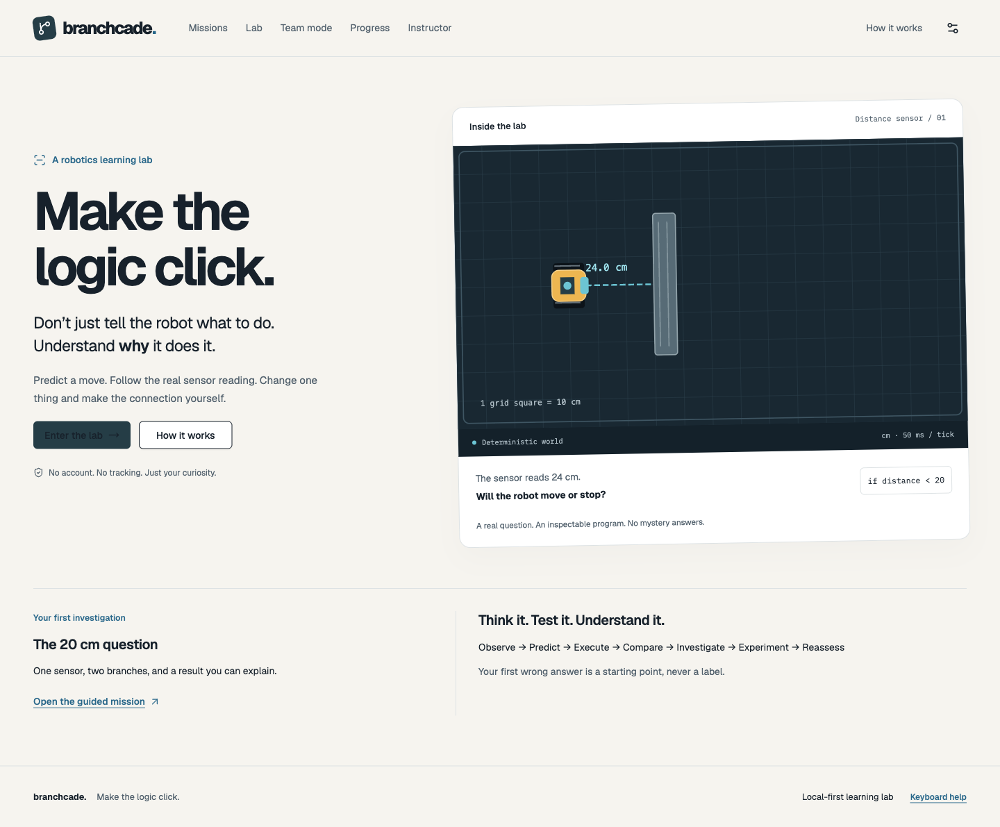

# Branchcade

**Make the logic click.** A browser-based robotics learning laboratory: predict a robot’s action, follow its actual sensor readings and execution trace, investigate surprising results, change one parameter and test your understanding with a different problem.



## What works in this checkpoint

This invocation implements master-prompt **Parts A–C**, with a real representative learning cycle, not the complete eight-mission competition release.

- One guided mission: **The 20 cm question**. At 24 cm, `24 <20` is false and the actual else branch moves10 cm.
- Prediction and confidence locked before reveal; exact operands and trace replay; no generated-code execution.
- Two diagnostic probes keep the first wrong answer ambiguous, then distinguish comparison direction from expecting a sensor to stop the robot itself.
- Bounded, executed counterexample search; threshold experiment; a different32 cm /35 cm transfer problem. No claim of mastery from one answer.
- Free lab: direct obstacle dragging and keyboard numeric controls, live centimeter measurements, threshold editing, actual Blockly workspace/JSON→typed AST, inert pseudocode and validated world export/import.
- Local anonymous learner progress, real instructor attempts/CSV, confirmed deletion, validated whole-dataset import/export, local 2–6-person private-prediction handoff and role rotation.
- Responsive working routes, keyboard dialogs, error/empty recovery, local theme/text/contrast/reduced-motion preferences, CI and persistent tests.

No fabricated progress, fake online teammates, copied proprietary robot artwork, ads, child accounts, remote learner records or LLM diagnosis. The creator’s motivation comes from teaching a small group of about six younger robotics students; no invented classroom outcomes or efficacy percentages.

## Install and run

Use maintained Node 24.22.1 (see `.nvmrc`), npm and the committed lockfile. The app requires **zero API keys**.

```bash
npm ci
npm run dev
# Open http://127.0.0.1:5173
npm run check
npx playwright install chromium firefox
npm run test:e2e
npm run format:check
npm run scan:secrets
```

`check` runs ESLint, strict TypeScript, Vitest and the production build. `npm run test -- --run` runs unit/integration/component tests; `npm run test:a11y` selects browser accessibility checks. Browser failure traces/screenshots are in `test-results/` and the HTML report in `playwright-report/`. Actual counts/results and failures repaired: [TEST_REPORT](docs/TEST_REPORT.md).

## Walk through the actual product

1. Home → Enter the lab → create the generated local alias.
2. Read24 cm and the if/else program. Predict **Stop in place** intentionally, then lock/run.
3. Inspect `24 <20 is false`, the else branch and actual 10 cm motion in the trace.
4. Answer **False:24 is greater than20**, then **Yes, the sensor stops it automatically**. Observe the tentative sensor-action explanation, not a label.
5. Generate the experiment; change threshold 20→30 and see the actual branch change while distance remains 24.
6. Reassess using32 cm /35 cm. Predict stop and reveal the real result. Open Progress/Instructor to inspect the saved record, export it or explicitly delete it.

These are demo instructions, not a claim that real children produced those answers. Correct initial predictions can skip remedial probes.

## Architecture and source tour

```text
validated World + typed Program AST
             ↓ bounded interpreter + fixed 50ms engine
passive sensor rays → actual events → goal predicates
             ↓
SVG / trace → prediction comparison → probes / counterexamples
             ↓
distinct transfer → versioned local IndexedDB → instructor / export
```

- `src/domain/{types,schemas,invariants}.ts`: versioned contracts, structural limits, canonical JSON and SHA-256 identities.
- `src/engine/{geometry,robot,sensors,reducer,replay}.ts`: centimeter geometry, substepped collisions, passive sensing, pause/reset and exact snapshots.
- `src/interpreter/`: validated AST, safe numeric/boolean evaluation, bounded loops/functions, real Blockly adapter and inert text previews.
- `src/learning/`: hypothesis library, explicit evidence rules, contradictions, bounded executed counterexamples and deduplicated transfer evidence.
- `src/missions/catalog.ts`: the one authored mission and distinct transfer variant. New missions must validate and demonstrate actual goal success/failure; changing a status flag is not completion.
- `src/storage/`: IndexedDB, guarded deterministic legacy migration, append-only execution records and validated import/export.
- `src/collaboration/`: local aliases, role responsibilities, private predictions and rotation.
- `src/features/`: working routes; `src/styles/`: design tokens; `tests/` and `e2e/`: persistent reproducible evidence.
- [ARCHITECTURE](docs/ARCHITECTURE.md), [DESIGN_SYSTEM](docs/DESIGN_SYSTEM.md), [ADR](docs/ADR.md), [HANDOFF](docs/HANDOFF.md), [STATUS](docs/STATUS.json), [original/full spec](docs/SPEC.md).

## Local data, privacy and access

A random pseudonym is enough. No age, email or real name is required. Records stay in this browser’s IndexedDB; a different browser/device does not automatically share them. Team mode is single-device pass-and-play, not internet multiplayer. Instructor metrics show this browser only.

Settings exports JSON and validates imports before an explicit replacement confirmation. Imports reject unknown versions, invalid geometry/ASTs, duplicate IDs, unsafe structure, identity/trace mismatches and unsupported completion claims. A documented pre-release v0 alias shape migrates deterministically; unknown data is not silently rewritten. Instructor exports CSV and confirms all-data deletion. Downloaded files are not deleted by clearing the app. On shared school devices, other people with the same browser profile can inspect local data. Do not put personal information in optional reasoning or exported files. Hosting services may log ordinary page requests.

[Security/privacy details](docs/SECURITY_PRIVACY.md). Local fonts and original SVGs avoid third-party asset requests. No analytics or remote error telemetry exists. Offline operation is limited to loaded/cached assets; no service-worker/PWA installation claim yet.

## Deployment readiness

`npm run build` produces `dist/`; `npm run preview -- --port 4173` serves it locally. SPA route fallback configs are included for Vercel (`vercel.json`) and Netlify/Cloudflare-compatible static hosting (`public/_redirects`). Deployment is **not claimed**: the existing Vercel CLI identity check returned an invalid-token error.

After the owner authorizes a hosting account, from this repository:

```bash
vercel login
vercel --prod
# Or publish dist/ to an authorized static host with SPA rewrites.
```

Then verify the actual public URL, direct `/missions/m01` refresh, privacy/network behavior and the guided journey. Never substitute localhost or an invented URL for deployment proof.

## Current limitations and next work

Parts D–L / the full later-phase gates are not complete. Only M01 is available; the full eight-mission curriculum, larger adaptive planner, advanced world authoring, complete Blockly function/variable toolbox, real-time playback/debugger, worker offloading, PWA and final contest release remain separate work. AST function/variable contracts and execution are implemented and tested, but the initial visual toolbox exposes a subset. Synchronous computation is bounded; the lazy Blockly bundle still emits a documented size warning (~790KB minified). No WebKit, real Chromebook hardware, human usability study or public deployment is claimed. ESLint 9 is retained for current jsx-a11y peer compatibility; its maintenance status is documented in ADR.

## Student ownership, AI disclosure and licensing

This session’s source, original SVGs, docs and tests are AI-assisted. Student review/contributions have **not** been invented. Creators must personally inspect and revise core algorithms, test actual behavior and document real work before competition submission. [AI_ASSISTANCE_LOG](docs/AI_ASSISTANCE_LOG.md) lists review questions. [USER_TESTING](docs/USER_TESTING.md) is a blank protocol, not fabricated results. [DEMO_SCRIPT](docs/DEMO_SCRIPT.md) and [SUBMISSION_GUIDE](docs/SUBMISSION_GUIDE.md) separate foundation from later shipping work. Third-party notices are in [LICENSE_NOTICES](docs/LICENSE_NOTICES.md). No LEGO or other proprietary affiliation is implied. The repository owner must choose the project’s distribution license; bundled dependencies retain theirs.

## Troubleshooting

- Blank/failed screen: use the visible reload recovery; inspect actual console errors, not a fabricated success message.
- Storage unavailable/corrupt: the visible notice identifies in-memory mode; export before closing. Erase requires explicit confirmation; imports never silently replace existing data.
- Missing editor socket/disconnected block: connect one supported program and Apply blocks; errors identify the block/input. Previews are not executable.
- Loop budget reached: reduce repeats or make the condition change; do not disable the budget.
- Port in use: choose another dev port; E2E expects 4173, so keep its configuration and preview consistent.
- Shared-computer continuation: fetch/pull clean main, read HANDOFF and run gates. Do not infer completion from chat history or a stale marker.
